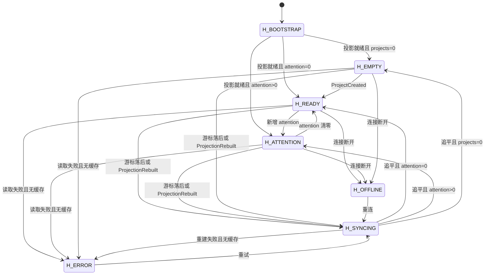
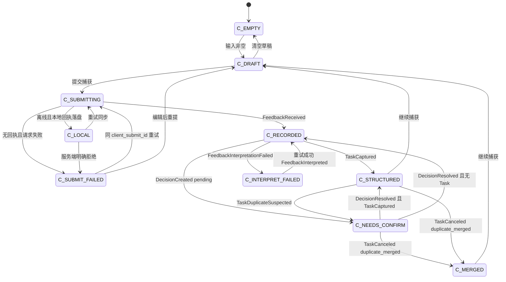
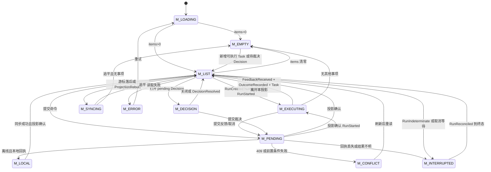
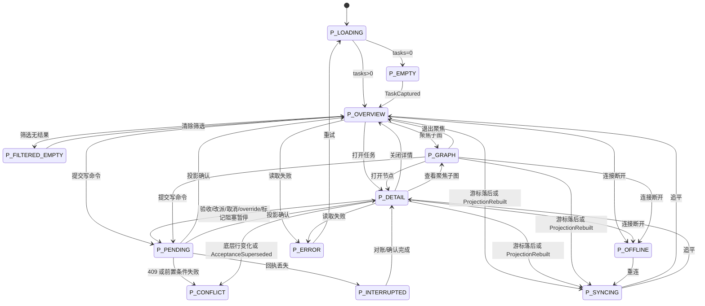

# 续行 K0 Web 交互契约（D9 质量门 · v0.2 定稿）

| 项 | 值 |
|---|---|
| 文档状态 | v0.2 定稿（2026-10-24；11 条 OQ 全部关闭，裁决索引见 §11）；已转正，Web 实现可开工 |
| 版本 | v0.2 |
| 分支 | `qoder/interaction-contract` |
| 基线 | `develop/eventstore-batch1` |
| 规范依据 | `spec/K0-SPEC-FROZEN-v1.0.md`（下称 Spec）、`docs/DECISIONS.md`、`README.md` |
| 覆盖范围 | Home / Capture / My Actions / Project 四入口的状态机、动作表、异常呈现；design tokens；UI 质感验收 checklist |
| 非范围 | `src/` 实现、API 最终形状、视觉稿、K1+ 能力 |

**引用约定**：`Spec §x` 指冻结版章节号；`REQ-* / INV-* / G* / C*` 均为 Spec 原文编号。凡 Spec 未规定、由本契约补充的交互决定，标注 `[交互层定义]`，并在 §10 登记。本文不发明 Spec 章节号。本文内部小节引用（如 §3.3、§4.3、§5.4）不带 `Spec` 前缀；带 `Spec` 前缀的编号均已在冻结版中存在。§9「落点」列的 `§x` 均指本文小节。**§0 全节均为 `[交互层定义]`**（F-004：Spec 未规定、由本契约补充的交互决定）。

---

## 0. 铁律、状态分层与异常协议

### 0.1 三条硬约束

1. **投影是唯一事实源**：任何断言领域事实的界面状态，必须能在投影中找到字段，且该字段可由事件流按 `global_seq` 重演得到（Spec §4 INV-12；验收 C5）。Home / My Actions / Project 投影由事件消费者维护，Task 行携带内核算出的 `available_actions[]`（Spec §6 REQ-PJ-1）。唯一例外为 §0.3 的 P 层传输缓冲（OQ-07=A，仅 Capture/Feedback 离线「已记录（待同步）」）。
2. **前端不自算状态逻辑**：前端不得自行推导 `lifecycle`、`wait_state`、`ready`、`accepted`、待办优先级或动作可用性；只渲染投影给出的值（Spec §6 REQ-PJ-1）。
3. **命令不乐观改变领域态**：点击动作后可以立即出现「处理中」的视觉反馈，但在对应事件进入投影前，界面不得显示新的领域状态（如「已通过」「已完成」「已取消」）。外部事件重复投递只入账一次（Spec §4 INV-13）。

### 0.2 三层状态：D / P / I

D9 的「UI 状态只能由事件流投影得出」按以下三层落地。只有 D 层被允许断言领域事实；P / I 层是呈现与输入，不得反向写领域态。

| 层 | 名称 | 例子 | 事实来源 | 可否断言领域事实 |
|---|---|---|---|---|
| D | 域态 | `task.lifecycle=ready`、`run.state=running`、`decision.status=pending`、`acceptance.verdict=partially_accepted` | 事件流投影（Spec §4、§6） | 是；必须有投影字段 |
| P | 呈现态 | 加载中、空、读取失败、离线、同步中、命令待确认、结果不明 | 投影游标与读取状态、连接状态、命令回执/本地传输缓冲 | 否；只能描述「数据/请求的可见性」 |
| I | 输入态 | 未提交草稿、筛选条件、当前选中的任务/图节点 | 用户输入、URL | 否；不持久化为领域事实 |

**渲染公式**：`UI = render(D, P, I)`。除这三类输入外不存在第四类可变状态。若某个界面状态无法由 D/P/I 表达，正确做法是**增加投影字段或命令回执字段**，而不是在组件内新增私有状态。P 层不是界面私有状态：它由投影游标、读取结果、连接状态三个外部事实唯一决定，组件不得自行写入；I 层只保存用户输入，不参与领域判定。

### 0.3 D9 与 REQ-FB-2 的边界

Spec §2.5 REQ-FB-2 明确允许离线时「客户端本地先行落盘并显示已记录，同步后以服务端事件为准；同步失败不回滚本地已记录显示，只更新同步徽标状态」。OQ-07=A 已裁决（2026-10-24）：本契约把它收敛为**P 层传输缓冲**（append-only 客户端投影；评审 M2 起改此名，不再称 outbox，以免与 D 层领域投影混淆）：

- P 层传输缓冲是 append-only、按 `client_submit_id` 幂等、可重放的客户端记录；它只允许产生 `C-LOCAL` / `M-LOCAL` 两个呈现态。
- 条目必须携带 `client_submit_id`；`FeedbackReceived` 回执必须可关联审计（同 id 对账，§6.4）。
- P 层传输缓冲**不得**派生 Task 已创建、Outcome 已入账、Acceptance 已通过等任何领域结论；`available_actions` 与一切内核判定不得消费其内容；界面必须同时显示同步徽标。
- 该例外不自动扩展到 K1；K1 设复审点，重新评估离线先行的范围与形态。

### 0.4 `available_actions[]` 契约

- 由内核按 `lifecycle / wait_state / actor 角色 / assignment / decision 归属` 计算（Spec §6 REQ-PJ-1）；前端只决定如何渲染，不得增删。
- 前端禁用某个动作只是**可用性提示**，不是授权；服务端必须按 Spec §3.1/§3.2 的迁移矩阵与 REQ 前置条件重新校验。
- 动作被禁用时必须给出原因码（如 `no_capable_actor`，Spec §5.2 REQ-SCH-4；`wait_state≠none`，Spec §3.1；`terminal_state`，Spec §3.1/§3.2），不得只置灰。

### 0.5 命令信封、回执与幂等

所有写动作统一使用：

```ts
interface CommandEnvelope {
  client_submit_id: string;      // ULID；重试必须复用
  idempotency_key: string;       // 与 client_submit_id 绑定
  expected?: {
    projection_seq?: number;     // 读取时的 as_of_global_seq
    task_lifecycle?: string;
    plan_rev?: number;
    assignment_id?: string;
    acceptance_id?: string;
  };
}
```

- 返回 `202 + receipt` 表示「已受理」，不表示领域动作已完成；界面进入 P 层「待确认」，直到投影出现对应事件。
- 返回 `409` 表示前置条件/版本冲突；界面进入冲突态，展示最新投影，不自动重试覆盖（Spec §5.1 REQ-PC-1 对 `base_rev_conflict` 明确要求返回三方差异，不自动重试）。
- 超时/断网导致结果未知：按 §0.7 处理，复用同一 `client_submit_id` 重试；不得生成第二个提交 id。

> **加注（F-010）**：命令层（K0-Q4）在 plan 落定后须复核 optimistic concurrency——`expected.plan_rev` 等前置字段不得沿用命令提交时的旧值，按最新投影重新校验后再放行；与本节 409 冲突处理互为表里。

### 0.6 错误码与呈现映射

| 错误码 | 典型触发 | 界面呈现 | 可重试 |
|---|---|---|---|
| `precondition_unmet` | Task 已不在 ready、wait_state 变化、Assignment 已结束 | 行级「状态已变化」+ 刷新；保留输入 | 刷新后由用户重新发起 |
| `terminal_state` | Task 已 accepted/canceled；Run 已终态 | 终态只读；移除动作；说明终态原因 | 否 |
| `base_rev_conflict` | PlanChange 的 `base_plan_rev` 不等于当前 rev（Spec §5.1 REQ-PC-1） | 展示当前 rev 与差异摘要；不自动覆盖、不自动重试 | 否；需重新提议 |
| `decision_expired` | Decision 已过期（Spec §2.7 REQ-DC-1） | 「已过期，未执行」；不得显示为批准 | 否；需重新产生 Decision |
| `duplicate` | 同 `client_submit_id` / `idempotency_key` 重放（Spec §4 INV-13） | 展示首次结果，不报错、不重复入账 | 是（幂等） |
| `forbidden` | actor 无权、Agent 验收自己执行的 Run（Spec §2.6 REQ-ACC-2） | 说明限制；不提供绕过入口 | 否 |
| `not_found` | 引用的 Task/Decision/Project 不存在或不在当前项目 | 回到列表并提示「已不存在，可能已被处理」 | 否 |
| `projection_stale` | 读模型游标落后于写入 | 保留快照 + 「同步中」徽标；游标落后超过阈值或涉及关键写动作时禁用写动作，其余仅徽标提示 | 是；追平后重试 |
| `offline` | 连接断开 | 离线徽标；仅 Capture/Feedback 允许本地先行 | 是 |
| `internal` | 未分类服务端错误 | 错误码 + request id + 重试；不展示堆栈 | 是 |

### 0.7 任务中断（I-1 会话中断 / I-2 执行中断）

**I-1 会话中断**：页面刷新、关闭、网络断开发生在命令提交后、投影确认前。

- 界面不得推断成功或失败；进入「结果待确认」。
- 以 `client_submit_id` 查询命令回执与投影；若对应事件已出现，按投影落地；若没有，允许用同一 key 重试。
- 草稿、附件、已填写的验收判据必须本地保留（I 层），恢复后回填。

**I-2 执行中断**：领域内的任务执行中断。

- `RunIndeterminate`（Spec §3.2、REQ-RUN-3）：显示「执行结果不明，等待对账/裁决」；在 `RunReconciled` 或 Decision 裁决前，不派发同契约范围的新 Run（REQ-RUN-2）。
- `TaskCancelRequested` 后等待在跑 Run 终态（Spec §3.2 REQ-RUN-6）：显示「取消中」，不得提前显示「已取消」。
- `human_light` Run 无租约、无心跳、无 `indeterminate/timed_out`（Spec §2.4、§5.7 REQ-HUM-1；OQ-06=A 已裁决）；页面关闭不等于执行失败，重新进入时仍按投影显示 `running`，允许继续提交或取消。

### 0.8 离线写权限矩阵

| 入口 | 读 | 写 | 本地先行 |
|---|---|---|---|
| Home | 缓存快照只读 | 禁用 | 否 |
| Capture | 本地传输缓冲 + 缓存回执 | 允许提交 | 是（REQ-FB-2） |
| My Actions | 缓存快照只读 | 仅 Feedback 允许本地先行；开始/取消/裁决/标记阻塞禁用 | 是（仅 Feedback） |
| Project | 缓存快照只读 | 全部禁用 | 否 |

离线时任何入口都必须显示同步徽标与「数据可能过期」；不得把缓存快照标成「当前」。

---

## 1. 四入口投影清单与事件映射

### 1.1 投影信封

四个投影共用：

```ts
interface ProjectionEnvelope<T> {
  projection_id: 'home' | 'capture' | 'my_actions' | 'project';
  project_id?: string;
  as_of_global_seq: number;     // 已消费到的全局序号
  head_global_seq: number;      // 服务端当前 head（读取时返回）
  lag_state: 'fresh' | 'catching_up' | 'rebuilding';
  generated_at: string;         // UTC ISO-8601
  rows: T[];
}
```

- `as_of_global_seq < head_global_seq` 或 `lag_state ≠ fresh` 时，界面必须显示同步状态（P 层）。
- `ProjectionRebuilt`（Spec §4）到达时，客户端丢弃旧快照并重读；不得把重建前快照继续当作当前。
- 投影重建的验收标准是「清空后按 `global_seq` 重演，逐字段 diff 为零」（Spec §8.2 C5）。
- `lag_state` 三值同口径落呈现（F-011）：`fresh` 不显示同步徽标；`catching_up` 与 `as_of_global_seq < head_global_seq` 同样显示同步徽标，各入口 `*-SYNCING` 同时覆盖这两种信号；`rebuilding`  additionally 按上一条丢弃旧快照并重读。

### 1.2 事件 → 投影映射（承重事件）

| 事件（Spec §4） | Home | Capture | My Actions | Project | 用途 |
|---|---|---|---|---|---|
| `ProjectCreated` | ✓ | | | ✓ | 项目出现；Home 空态退出 |
| `GoalCreated` / `GoalStatusChanged` | ✓ | | | ✓ | 目标陈述与状态 |
| `TaskCaptured` | ✓ | ✓ | ✓ | ✓ | Task 行出现；Capture「已成 Task」 |
| `TaskDefined` / `ContractUpdated` | ✓ | | ✓ | ✓ | 契约版本、结构化完成 |
| `TaskLifecycleChanged` | ✓ | | ✓ | ✓ | 生命周期列、My Actions 过滤、验收后状态 |
| `TaskWaitStateChanged` | ✓ | | ✓ | ✓ | wait_state 叠加/解除；My Actions 可执行性 |
| `TaskCancelRequested` / `TaskCanceled` | ✓ | ✓ | ✓ | ✓ | 「取消中」/终态；Capture 合并结果 |
| `TaskDuplicateSuspected` / `TaskDuplicateResolved` | ✓ | ✓ | ✓ | ✓ | 疑似重复标记、裁决 CTA |
| `AssignmentCreated` / `AssignmentEnded` | | | ✓ | ✓ | 当前用户待办归属；INV-14 |
| `RunCreated` / `RunStarted` | | | ✓ | ✓ | human_light「执行中」、agent Run 状态 |
| `RunSucceeded` / `RunFailed` / `RunCanceled` / `RunTimedOut` | | | ✓ | ✓ | 执行终态；Run 历史 |
| `RunIndeterminate` / `RunReconciled` | ✓ | | ✓ | ✓ | 「结果不明」attention 与对账 |
| `FeedbackReceived` | | ✓ | ✓ | ✓ | Capture 回执；人类反馈入账 |
| `FeedbackInterpreted` / `FeedbackInterpretationFailed` | | ✓ | ✓ | | 整理中/整理失败；原文不丢 |
| `OutcomeRecorded` | ✓ | ✓ | ✓ | ✓ | 结果入账；Task → awaiting_acceptance |
| `AcceptanceRecorded` / `AcceptanceSuperseded` | ✓ | | | ✓ | 验收结论、待补判据、下游传播 |
| `WaitConditionCreated` / `Satisfied` / `Expired` / `Canceled` | ✓ | | ✓ | ✓ | 等待状态与提醒 |
| `DecisionCreated` / `DecisionResolved` / `DecisionExpired` | ✓ | ✓ | ✓ | ✓ | 待裁决项；过期≠批准 |
| `PlanChangeProposed` / `Applied` / `Rejected` / `StatusChanged` | ✓ | ✓ | ✓ | ✓ | 计划版本、needs_decision、Capture 整理结果 |
| `PlanRevisionCreated` | ✓ | | | ✓ | 计划版本号与差异 |
| `EdgeAdded` / `EdgeRemoved` | | | | ✓ | 图视图与聚焦子图 |
| `ReleaseOverrideSet` / `ReleaseOverrideInvalidated` | | | | ✓ | 放行状态与边详情 |
| `LatestAcceptedPointerMoved` | | | | ✓ | `data_from=latest_accepted` 可用性 |
| `ProjectionRebuilt` | ✓ | ✓ | ✓ | ✓ | 失效重读、重建进度 |

> 事件 payload 形状不在本契约固定；本契约只要求投影能提供下文列举的字段，且每个字段可追溯到上表事件。

### 1.3 规模概览

| 入口 | 状态数 | 动作数 | 状态图 |
|---|---|---|---|
| Home | 7 | 4 | §2.6 |
| Capture | 10 | 8 | §3.6 |
| My Actions | 11 | 9 | §4.6 |
| Project | 12 | 11 | §5.6 |
| **合计** | **40** | **32** | 4 张 |

---

## 2. Home

### 2.1 职责

跨项目聚合入口：展示项目、需要当前用户关注的事项、最近活动；不在此页直接裁决或验收，只做导航与信息展示（OQ-05=B：项目/目标由种子数据/CLI 创建，Home 为纯投影，不提供创建写动作）。Home 不制造待办：没有 attention 时只展示项目与活动（Spec §1.1 第 5 项；§6 REQ-PJ-1）。

### 2.2 投影契约

```ts
interface HomeProjection {
  projects: Array<{
    project_id: string;
    name: string;
    goal_statement: string | null;
    goal_status: 'active' | 'achieved' | 'abandoned' | null;
    task_counts: Record<TaskLifecycle, number>;
    last_activity_at: string | null;
  }>;
  attention: Array<{
    attention_id: string;
    kind: 'decision_pending' | 'acceptance_due' | 'run_indeterminate'
        | 'duplicate_suspect' | 'wait_expired' | 'cancel_pending';
    project_id: string;
    task_id?: string;
    decision_id?: string;
    rank: number;                 // 内核计算（OQ-08=A），前端只按此排序
    available_actions: string[];  // 内核计算（REQ-PJ-1）
    created_at: string;
  }>;
  recent: Array<{
    event_id: string;
    project_id: string;
    task_id?: string;
    summary: string;              // 服务端确定性文案，不由前端拼领域结论
    occurred_at: string;
  }>;
}
```

**attention 派生规则**：

| kind | 出现 | 消失 |
|---|---|---|
| `decision_pending` | `DecisionCreated` 且 `status=pending` | `DecisionResolved` / `DecisionExpired` |
| `acceptance_due` | `TaskLifecycleChanged` 到 `awaiting_acceptance` 且（无有效 Acceptance 或最新有效 Acceptance.verdict=partially_accepted） | `AcceptanceRecorded` 且 verdict=accepted/rejected；partially 仍保留「待补判据」 |
| `run_indeterminate` | `RunIndeterminate` | `RunReconciled` 到终态，或 Decision 裁决 |
| `duplicate_suspect` | `TaskDuplicateSuspected` | `TaskDuplicateResolved` / `TaskCanceled` |
| `wait_expired` | `WaitConditionExpired` | 后续 `WaitConditionSatisfied` / `WaitConditionCanceled` 或 Task 终态 |
| `cancel_pending` | `TaskCancelRequested` 且尚无 `TaskCanceled` | `TaskCanceled` |

### 2.3 状态集（7）

| ID | 状态 | 一句话定义 | 由哪些事件/投影派生 |
|---|---|---|---|
| H1 | `H-BOOTSTRAP` | 首次进入或投影快照不可用，只显示与最终布局同形的骨架，不显示任何计数或零值。 | 无 `as_of_global_seq` / 读模型未返回；无内核事件（P 层） |
| H2 | `H-EMPTY` | 投影就绪且没有任何项目，展示首启说明与只读引导（项目/目标由种子/CLI 创建，OQ-05=B）。 | 已消费事件中无 `ProjectCreated`（Spec §2.1、§4） |
| H3 | `H-READY` | 投影就绪、有项目且 `attention=[]`，展示项目与最近活动，不制造待办。 | `projects>0 ∧ attention=[]`；项目来自 `ProjectCreated`，计数来自 `TaskCaptured` / `TaskLifecycleChanged`，活动来自事件流 `global_seq` |
| H4 | `H-ATTENTION` | `attention>0`，按内核 `rank` 展示待处理项，不在此页直接改领域态。 | 上表六类 attention 事件；移除事件见上表 |
| H5 | `H-SYNCING` | 投影游标落后于服务端 head 或正在重建，保留最后快照并显示同步徽标。 | `as_of_global_seq < head_global_seq` 或 `lag_state=rebuilding`；`ProjectionRebuilt` 触发重读（Spec §4、§8.2 C5） |
| H6 | `H-OFFLINE` | 连接断开，展示缓存快照并禁用写操作。 | 连接状态；无内核事件（P 层） |
| H7 | `H-ERROR` | 投影读取失败且无可用缓存，显示错误码、request id 与重试。 | 读取错误；无内核事件（P 层） |

### 2.4 动作表（4）

（M3：原 H-A1「新建项目 `create_project`」按 OQ-05=B 移除——项目/目标由种子数据/CLI 创建，Home 为纯投影，空态只读 CTA；Home 动作 5→4，原 H-A2~H-A5 编号保持不变。）

| # | 动作 | 类型 | 前置状态 | 触发后状态变化 | 失败/异常呈现 |
|---|---|---|---|---|---|
| H-A2 | 打开项目 `open_project` | 导航 | `H-READY` / `H-ATTENTION` / `H-SYNCING` | 无领域事件；进入 Project | 目标不存在 →「项目已不存在，已返回列表」；同步中允许用缓存打开，但显示过期徽标 |
| H-A3 | 处理关注项 `open_attention` | 导航 | `H-ATTENTION` | 无领域事件；打开对应 Task/Decision | 点击前项已被处理 →「已处理，已刷新」，不弹错误；Decision 已过期 → 展示过期状态而非批准 |
| H-A4 | 快速捕获 `open_capture` | 导航 | 任意已加载状态 | 无领域事件；进入 Capture | 离线仍可进入；不把 Home 草稿带入 Capture，避免隐式状态 |
| H-A5 | 重试/刷新 `reload_projection` | 读 | `H-ERROR` / `H-SYNCING` / `H-OFFLINE` | 无领域事件；重新读取/重订阅：`H-ERROR` 重试统一进 `H-SYNCING`（F-006），追平后按投影落 `H-READY`/`H-ATTENTION`/`H-EMPTY` | 连续失败 → 保留错误码与 request id；不得清空已有快照，除非重建明确失败 |

### 2.5 异常呈现矩阵（Home）

| 情形 | 呈现 | 禁止 |
|---|---|---|
| 空态 | `H-EMPTY`：首启说明 + 只读引导（项目/目标由种子/CLI 创建，OQ-05=B；CTA 引导至 Capture）；`H-READY` 但无活动：一句「暂无最近活动」，不占大块空白 | 显示 `0` 个任务/`0` 个项目的整页仪表盘；用假数据填充；在 Home 提供创建写动作 |
| 加载中 | `H-BOOTSTRAP` 骨架与最终布局同形；局部 section 用骨架；操作按钮不因后台同步而抖动 | 先闪 `H-EMPTY` 再跳数据；全屏 spinner 遮住已加载内容 |
| 错误 | 无缓存 → 整页错误；有缓存 → 顶部错误条 + 旧快照 +「数据可能过期」；attention section 失败不拖垮项目列表 | 只显示「出错了」；把读取失败当成空态 |
| 任务中断 | 订阅断开/重建 → `H-SYNCING`，保留最后快照；恢复后从 `as_of_global_seq` 续读；导航动作不阻塞 | 把旧快照标成当前；自动把未确认的写动作重复提交 |
| 并发变更 | 关注项在点击前被处理 → 提示「已处理」并刷新；Decision 过期 → 过期态；项目计数以最新投影为准 | 保留已消失的待办；自动重试导致重复 Decision |

### 2.6 Mermaid 状态图



---

## 3. Capture

### 3.1 职责

单条输入的快速捕获：一次请求内返回「已记录」回执（含本地 id 映射），分类/结构化异步补齐；界面必须区分「已记录，整理中」与「已成 Task」（Spec §6 REQ-PJ-3）。Capture 不直接生成 Outcome、不直接裁决 Decision、不直接写 Acceptance。

### 3.2 投影契约与捕获落点

**OQ-01=A 已裁决（2026-10-24，D10）**：K0 事件目录（Spec §4）没有独立的 Capture 实体/事件；本契约按选项 A 把一条捕获落为**游离 Feedback**（`task_id=null`），即 `FeedbackReceived`，再由 Intent Interpreter 提议产生 `TaskCaptured` / PlanChange，**不新增实体**。落点链固定为：`FeedbackReceived` → `FeedbackInterpreted`（Interpreter 提议）→ `TaskCaptured`（直接成 Task）或 `PlanChangeProposed`（`needs_decision` → `DecisionCreated(pending)` → `DecisionResolved` → `PlanChangeApplied`/`PlanChangeRejected` → 对应 `TaskCaptured`）。该映射与 Spec §2.5 Feedback、§5.7 REQ-HUM-2「无绑定的游离 Feedback 只入账并触发解释」一致；K0 不新增 Capture 实体/事件（若未来修订，只需替换事件名，不改状态与动作结构）。

```ts
interface CaptureProjection {
  receipts: Array<{
    client_submit_id: string;
    feedback_id: string | null;      // FeedbackReceived 后出现
    task_id: string | null;          // TaskCaptured 后出现
    decision_id: string | null;      // DecisionCreated 后出现
    merged_into_task_id: string | null; // duplicate_merged 后出现
    phase: 'recorded' | 'interpreted' | 'task_created'
         | 'needs_confirmation' | 'interpretation_failed' | 'merged';
    interpretation_status: 'pending' | 'interpreted' | 'failed' | null;
    created_at: string;
    updated_global_seq: number;
    available_actions: string[];     // 内核计算
  }>;
}
```

**P 层传输缓冲（原 outbox，M2 改称；OQ-07=A 认可为 append-only 客户端投影）**：`{ client_submit_id, text, attachments?, created_at, sync_state: 'pending'|'syncing'|'failed' }`，append-only、按 `client_submit_id` 幂等、可重放；条目必须携带 `client_submit_id`，使 `FeedbackReceived` 回执可关联审计；只支撑 `C-LOCAL`，不支撑任何 Task 结论，也禁止被 `available_actions` 与内核判定消费。

**派生规则**：

| 投影字段 | 来源事件 |
|---|---|
| `feedback_id` / `phase=recorded` | `FeedbackReceived` |
| `interpretation_status` | `FeedbackInterpreted` / `FeedbackInterpretationFailed`；初始 `FeedbackReceived` 后为 `pending` |
| `phase=interpreted` | `FeedbackInterpreted`，且尚无 Task/Decision |
| PlanChange 提议出现 | `FeedbackInterpreted` 后 Interpreter 提议 `PlanChangeProposed`（M1 补齐落点链；`needs_decision` 时进 decision_id 行） |
| `task_id` / `phase=task_created` | `TaskCaptured`（或 PlanChange 应用后产生的对应 TaskCaptured） |
| `decision_id` / `phase=needs_confirmation` | `DecisionCreated` 且 `status=pending`，subject 指向该回执/候选 Task |
| `phase=interpretation_failed` | `FeedbackInterpretationFailed` |
| `merged_into_task_id` / `phase=merged` | `TaskCanceled`，原因 `duplicate_merged`（Spec §5.3 REQ-DD-2） |

### 3.3 状态集（10）

| ID | 状态 | 一句话定义 | 由哪些事件/投影派生 |
|---|---|---|---|
| C1 | `C-EMPTY` | 输入框为空且没有进行中的提交，展示输入提示与最近回执。 | 输入态（I 层）；无内核事件 |
| C2 | `C-DRAFT` | 输入非空、尚未提交，只有本地草稿。 | 输入态（I 层）；无内核事件 |
| C3 | `C-SUBMITTING` | 已提交、尚未收到服务端回执，本地传输缓冲进入 `syncing`。 | 命令回执（P 层）；尚无 `FeedbackReceived` |
| C4 | `C-LOCAL` | 离线或网络中断，本地传输缓冲已落盘并显示「已记录（待同步）」；服务端尚无 `FeedbackReceived`。 | 本地传输缓冲 + 连接状态；REQ-FB-2 明许的本地先行（P 层） |
| C5 | `C-RECORDED` | `FeedbackReceived` 已投影，尚无 `TaskCaptured` / `DecisionCreated`，显示「已记录，整理中」。 | `FeedbackReceived`，`interpretation_status=pending/interpreted`（Spec §2.5、§6 REQ-PJ-3） |
| C6 | `C-STRUCTURED` | `TaskCaptured` 已投影且回执携带 `task_id`，显示「已成 Task」并可打开。 | `TaskCaptured` |
| C7 | `C-NEEDS-CONFIRM` | `DecisionCreated(pending)` 指向该回执/候选 Task，显示裁决 CTA。 | `TaskDuplicateSuspected` 或 PlanChange `needs_decision` → `DecisionCreated`（Spec §5.3、§5.1 REQ-PC-3/5） |
| C8 | `C-INTERPRET-FAILED` | 解析失败但原文仍在，显示「已记录，整理失败」与重试。 | `FeedbackInterpretationFailed`（REQ-FB-1） |
| C9 | `C-SUBMIT-FAILED` | 没有 `FeedbackReceived` 且请求终态失败，显示错误并保留文本。 | 命令回执失败 + 投影无对应事件（P 层） |
| C10 | `C-MERGED` | 候选 Task 因疑似重复被合并，回执指向目标 Task，显示「已合并」而非「已成 Task」。 | `TaskCanceled` 原因 `duplicate_merged`（Spec §5.3 REQ-DD-2） |

### 3.4 动作表（8）

| # | 动作 | 类型 | 前置状态 | 触发后状态变化 | 失败/异常呈现 |
|---|---|---|---|---|---|
| C-A1 | 提交捕获 `submit_capture` | 写 | `C-DRAFT`；离线允许（本地先行）；文本非空 | `FeedbackReceived`（游离 Feedback，`task_id=null`）→ `C-RECORDED`；离线 → `C-LOCAL` | 按钮 ≤100ms 进入 pending；4xx 校验错误内联、保留文本；超时 → `C-SUBMIT-FAILED`「结果待确认」；同 `client_submit_id` 重试幂等（INV-13） |
| C-A2 | 重试同步 `retry_sync` | 写 | `C-LOCAL` | 重投同一 `client_submit_id`；成功 → `C-RECORDED`；仍离线 → 留在 `C-LOCAL`，徽标更新 | 网络失败只更新同步徽标，不回滚「已记录」显示（REQ-FB-2）；服务端明确拒绝 → `C-SUBMIT-FAILED` 并保留原文 |
| C-A3 | 重试整理 `retry_interpretation` | 写 | `C-INTERPRET-FAILED` | 重新触发解释；成功 → `FeedbackInterpreted`，回 `C-RECORDED`；仍失败 → 留在 `C-INTERPRET-FAILED` | 重试失败不丢原文（REQ-FB-1）；不得为重试生成第二条 `FeedbackReceived`；重试次数/退避属实现细节，不在本契约固定 |
| C-A4 | 打开已生成 Task `open_task` | 导航 | `C-STRUCTURED` / `C-MERGED` | 无领域事件；打开 Project 任务详情 | Task 已终态 → 打开只读详情并显示终态；不存在 → 回执列表并提示 |
| C-A5 | 去裁决 `open_decision` | 导航 | `C-NEEDS-CONFIRM` | 无领域事件；打开 Decision 详情 | Decision 已裁决/过期 → 显示最新状态，不重复裁决；不得在 Capture 内直接改领域态 |
| C-A6 | 清空草稿 `clear_draft` | 输入 | `C-DRAFT` / `C-SUBMIT-FAILED` | 无领域事件；回 `C-EMPTY` | 不删除已提交回执；只在本地草稿层清空 |
| C-A7 | 恢复上次提交 `reconcile_receipt` | 读 | `C-SUBMITTING` / `C-LOCAL` / `C-SUBMIT-FAILED` 且页面重载 | 按 `client_submit_id` 查回执与投影：有 `FeedbackReceived` → `C-RECORDED`；有 Task → `C-STRUCTURED`；无 → `C-SUBMIT-FAILED` | 查询失败 → 保持「结果待确认」，提供重试；不得自动重新提交并生成新 id |
| C-A8 | 继续捕获 `new_capture` | 输入 | `C-STRUCTURED` / `C-MERGED` | 无领域事件；清空输入，回 `C-EMPTY`；历史回执保留 | 不覆盖上一条回执；历史回执仍可打开 |

### 3.5 异常呈现矩阵（Capture）

| 情形 | 呈现 | 禁止 |
|---|---|---|
| 空态 | `C-EMPTY`：输入提示 + 最近回执为空说明；不显示「无数据」大插画占满屏 | 把「输入为空」说成系统失败 |
| 加载中 | 回执列表骨架；提交按钮 pending；已输入文本不被清空；解析中显示「已记录，整理中」而不是转圈遮罩 | 用全屏 spinner 阻挡继续输入；在 `FeedbackReceived` 前显示「已成 Task」 |
| 错误 | 提交失败内联在输入框下；解析失败显示「已记录，整理失败」+ 重试；离线显示「已记录（待同步）」+ 同步徽标 | 丢原文；把解析失败显示成「未记录」；把本地回执显示成服务端已确认 |
| 任务中断 | 页面关闭/刷新发生在提交后 → 重载按 `client_submit_id` 对账；有 `FeedbackReceived` 则 `C-RECORDED`，无则 `C-SUBMIT-FAILED`「结果待确认」 | 自动生成第二个提交 id；把「待确认」显示成成功或失败 |
| 并发变更 | 疑似重复 → `C-NEEDS-CONFIRM`；Decision 已被他人裁决 → 刷新到最新 `C-STRUCTURED`/`C-MERGED`/`C-RECORDED`；同一 `client_submit_id` 重放 → 返回首次结果（INV-13） | 自动合并；自动重复建 Task；在 Decision 未裁决前显示「已成 Task」 |

### 3.6 Mermaid 状态图



---

## 4. My Actions

### 4.1 职责与过滤

My Actions 只展示当前用户**真正可执行**的事项：`actor=当前用户 ∧ (可执行[ready/active 且 wait_state=none] ∨ 待其决策的 Decision)`；等待他人/Agent 的条目不入此投影（Spec §6 REQ-PJ-2）。`awaiting_acceptance` 不在 REQ-PJ-2 的集合内，验收动作放在 Project 任务详情，由 Home attention 的「待验收」跳转（OQ-02=A，2026-10-24）。待裁决 Decision 含 REQ-RUN-3 对账产生的 Decision（OQ-10=A）。

### 4.2 投影契约

```ts
interface MyActionsProjection {
  items: Array<{
    item_id: string;
    kind: 'task' | 'decision';
    project_id: string;
    task_id?: string;
    decision_id?: string;
    task_lifecycle?: TaskLifecycle;
    task_wait_state?: TaskWaitState;
    active_run?: {
      run_id: string;
      run_kind: 'executor' | 'human_light';
      state: RunState;
    };
    decision?: {
      question: string;
      recommendation: string | null;
      alternatives: string[];
      evidence_refs: string[];
      status: 'pending' | 'approved' | 'approved_modified' | 'rejected' | 'deferred' | 'expired';
      expires_at: string | null;
    };
    rank: number;                  // 内核计算（OQ-08=A），前端只排序
    available_actions: string[];
    blocked_reason: string | null;   // 如 no_capable_actor、wait_state
    updated_global_seq: number;
  }>;
}
```

**派生规则**：

- Task 项：`TaskLifecycleChanged` / `TaskWaitStateChanged` / `AssignmentCreated` / `AssignmentEnded` / `RunCreated` / `RunStarted` / `RunSucceeded` / `RunFailed` / `RunCanceled` / `RunTimedOut` / `RunIndeterminate` / `RunReconciled` / `OutcomeRecorded` / `TaskCancelRequested` / `TaskCanceled`。
- Decision 项：`DecisionCreated`（pending，含 Run 对账 Decision，OQ-10=A）/ `DecisionResolved` / `DecisionExpired`。
- 过滤与 `available_actions` 由内核完成（REQ-PJ-1/2）；前端不得本地补项或删项。

### 4.3 状态集（11）

| ID | 状态 | 一句话定义 | 由哪些事件/投影派生 |
|---|---|---|---|
| M1 | `M-LOADING` | 首次加载或投影不可用，只显示列表骨架，不显示空态文案。 | 无 `as_of_global_seq`；P 层 |
| M2 | `M-EMPTY` | 投影就绪且 `items=[]`，说明只显示「可执行任务」与「待你裁决」两类，并给 Capture/Home 链接。 | MyActions 投影零行；过滤规则见 REQ-PJ-2 |
| M3 | `M-LIST` | `items>0` 且没有进行中的执行/决策详情，按内核 `rank` 展示列表。 | Task/Decision 投影行；事件见 §4.2 |
| M4 | `M-EXECUTING` | 至少一项存在 `run_kind=human_light ∧ state=running`，该项展示「进行中/提交结果」。 | `RunCreated`（human_light）+ `RunStarted`；Task `TaskLifecycleChanged` ready→active（REQ-HUM-1） |
| M5 | `M-DECISION` | 打开了某个 `Decision.status=pending` 的详情，展示问题、建议、备选与证据。 | `DecisionCreated`（pending）；选择态（I 层）+ 投影 |
| M6 | `M-PENDING` | 一个命令已提交、等待投影确认；只做行级 pending，不改变域态。 | 命令回执（P 层）；尚无对应事件 |
| M7 | `M-LOCAL` | 离线提交的 Feedback 已在本地传输缓冲，显示「已记录（待同步）」。 | 本地传输缓冲 + 连接状态；REQ-FB-2（P 层） |
| M8 | `M-CONFLICT` | 最近命令被前置条件拒绝或投影已变化，显示「状态已变化」。 | `409` / `precondition_unmet` / `terminal_state` / `base_rev_conflict` / `decision_expired`；最新投影 |
| M9 | `M-INTERRUPTED` | 结果未知：`RunIndeterminate`、取消等待确认，或命令回执丢失；显示「结果待确认/对账中」。 | `RunIndeterminate` / `TaskCancelRequested` 未 `TaskCanceled` / 命令超时（Spec §3.2、REQ-RUN-3/6） |
| M10 | `M-SYNCING` | 投影游标落后或正在重建，保留列表并显示同步徽标。 | `as_of_global_seq < head_global_seq` / `ProjectionRebuilt` |
| M11 | `M-ERROR` | 投影读取失败，显示错误码、request id 与重试。 | 读取错误；P 层 |

### 4.4 动作表（9）

| # | 动作 | 类型 | 前置状态 | 触发后状态变化 | 失败/异常呈现 |
|---|---|---|---|---|---|
| M-A1 | 开始执行 `start_task` | 写 | `M-LIST` 中 Task 为 `ready`、`wait_state=none`、Assignment 属当前用户、`available_actions` 含 `start` | `RunCreated`（human_light）+ `RunStarted`；Task `TaskLifecycleChanged` ready→active（REQ-HUM-1）；→ `M-EXECUTING` | 不在 ready / wait_state 变化 / Assignment 已结束 → `M-CONFLICT`，「状态已变化」+ 刷新；超时 → `M-INTERRUPTED`，按 `client_submit_id` 查询，若 `RunCreated` 已存在则进 `M-EXECUTING` |
| M-A2 | 提交反馈/结果 `submit_feedback` | 写 | `M-EXECUTING`，human_light Run 为 `running`；文本非空 | `FeedbackReceived` → 异步 `FeedbackInterpreted` / `OutcomeRecorded`；`RunSucceeded`；Task `TaskLifecycleChanged` active→awaiting_acceptance（REQ-HUM-2） | 离线 → `M-LOCAL`；解析失败 → `FeedbackInterpretationFailed`，显示「已记录，整理失败」+ 重试，原文不丢；Run/Task 已终态 → `M-CONFLICT`；超时 → 保留输入 + 「结果待确认」，同 id 重试 |
| M-A3 | 取消任务 `cancel_task` | 写 | 非终态 Task；`available_actions` 含 `cancel` | `TaskCancelRequested`；冻结新 Run；级联收尾（REQ-RUN-6）；全部 Run 终态后 `TaskCanceled` | 已终态 → `M-CONFLICT`；running executor 未确认 → `RunIndeterminate` + Decision，显示「取消中，结果待确认」；`human_light` 直接 `RunCanceled`；取消意图不可撤销（REQ-RUN-6），必须二次确认 |
| M-A4 | 裁决 Decision `resolve_decision` | 写 | `M-DECISION` 且 `status=pending` | `DecisionResolved`（approved / approved_modified / rejected / deferred）；approve 后按 REQ-PC-5 以当前 rev 重走完整校验 → `PlanChangeStatusChanged` / `PlanChangeApplied` 或 `PlanChangeRejected` | 已过期 → `decision_expired`「已过期，未执行」（REQ-DC-1）；已裁决 → `M-CONFLICT` 展示最新；`base_rev_conflict` → 展示当前 rev 与差异，不自动重试；`approved_modified` 置灰并提示走 API（OQ-04=B：K0 不提供 PlanChange 提案表单；REQ-PC-5 禁止原地改 ops，须另提交新 PlanChange） |
| M-A5 | 打开任务/证据 `open_task` | 导航 | `M-LIST` / `M-EXECUTING` / `M-DECISION` | 无领域事件；打开 Project 任务详情或证据只读视图 | 目标已终态/不存在 → 只读展示或回列表；不得从详情页绕过 Project 的验收入口 |
| M-A6 | 重试同步 `retry_sync` | 写 | `M-LOCAL` | 重投同一 Feedback；成功 → 投影出现 `FeedbackReceived` / `OutcomeRecorded`；→ `M-LIST` / `M-EMPTY` | 失败只更新同步徽标，不回滚「已记录」（REQ-FB-2） |
| M-A7 | 刷新/重试读取 `reload_projection` | 读 | `M-ERROR` / `M-SYNCING` / `M-CONFLICT` | 无领域事件；重读/重订阅 | 失败保留错误码；不得清空已输入草稿 |
| M-A8 | 恢复/继续上次执行 `resume_execution` | 输入 | `M-EXECUTING`（页面重载后 human_light 仍 `running`） | 无领域事件；回填未提交草稿，仍显示 `running` | 若投影显示 Run 已终态 → 转 `M-CONFLICT`/`M-LIST`，不把旧草稿当新提交；若 Task 已取消 → 只读展示 |
| M-A9 | 标记阻塞/暂停 `mark_blocked` | 写 | **K0 不提供（OQ-11=C）**：该入口仅 Project 详情开放（见 P-A11）；My Actions 不出现此动作 | 若经 Project 详情发起：`TaskWaitStateChanged` → `blocked`/`on_hold`（Spec §3.1 人工直接置位，不经 WaitCondition）；解除 → `none` | 理由必填；已终态 → 冲突态；并发置位 → 刷新最新 `wait_state`，不自动覆盖 |

### 4.5 异常呈现矩阵（My Actions）

| 情形 | 呈现 | 禁止 |
|---|---|---|
| 空态 | `M-EMPTY`：一句「当前没有需要你处理的事项」+ 说明只显示可执行任务与待你裁决的 Decision；给 Capture/Home 链接 | 把等待他人/Agent 的条目塞进来（违反 REQ-PJ-2）；显示成系统异常 |
| 加载中 | `M-LOADING` 列表骨架；行级动作 pending；开始/提交后不整页转圈 | 先闪空态；用 spinner 覆盖已有列表 |
| 错误 | 读取失败 → `M-ERROR` 整页/区块错误；动作失败 → 行内错误 + 原因码；保留输入 | 把动作失败显示成领域成功；只显示「出错了」 |
| 任务中断 | `RunIndeterminate` / 取消等待 → `M-INTERRUPTED`「结果待确认/对账中」；human_light 页面重载仍 `running` → `M-EXECUTING`「未提交」；命令回执丢失 → 按 `client_submit_id` 对账 | 自动重新开始新 Run（REQ-RUN-2 禁止 indeterminate 未对账前派发同契约新 Run）；提前显示「已取消」；把页面关闭当成执行失败 |
| 并发变更 | 409 → `M-CONFLICT`；展示最新 `lifecycle/wait_state/assignment/decision`；Decision 已过期 → 过期态；Assignment 已结束 → 移除动作 | 自动重试覆盖；继续用旧 `available_actions`；把 `expired` 当批准（REQ-DC-1） |

### 4.6 Mermaid 状态图



---

## 5. Project

### 5.1 职责

单项目工作台：概览（目标、计划版本、计数）、任务列表、任务详情与只读聚焦子图（Spec §1.1 第 5 项）。Project 是验收、改派、取消、release_override、标记阻塞/暂停（OQ-11=C）的操作落点；图视图只做聚焦子图只读渲染（固定 1-hop `depends_on` + `data_from`，不显示 `conflicts_with`/`supersedes`，OQ-09=A），不提供拖拽编辑、不新增边。

### 5.2 投影契约

```ts
interface ProjectProjection {
  project_id: string;
  name: string;
  goal: {
    statement: string;
    success_criteria: string;
    stop_conditions: string;
    status: 'active' | 'achieved' | 'abandoned';
  } | null;
  plan_rev: number;
  plan_history: Array<{ rev: number; applied_at: string; diff_summary: string }>;
  tasks: Array<{
    task_id: string;
    title: string;
    lifecycle: TaskLifecycle;
    wait_state: TaskWaitState;
    duplicate_suspect: boolean;
    current_contract_rev: number;
    assignee: { actor_id: string; actor_kind: 'human' | 'agent' } | null;
    active_run: { run_id: string; state: RunState; run_kind: 'executor' | 'human_light' } | null;
    last_outcome_id: string | null;
    acceptance_summary: {
      verdict: 'accepted' | 'rejected' | 'partially_accepted' | null;
      pending_criteria: string[];   // partially 的待补集
    };
    available_actions: string[];
    updated_global_seq: number;
  }>;
  focused_subgraph: {             // 固定 1-hop depends_on + data_from，只读（OQ-09=A）；不显示 conflicts_with/supersedes
    root_task_id: string;
    nodes: Array<{ task_id: string; title: string; lifecycle: TaskLifecycle }>;
    edges: Array<{ edge_id: string; from_task: string; to_task: string; kind: EdgeKind; data_mode?: string; release_override_active?: boolean }>;
  } | null;
}
```

**派生来源**：`ProjectCreated`、`GoalCreated`、`GoalStatusChanged`、`TaskCaptured`、`TaskDefined`、`ContractUpdated`、`TaskLifecycleChanged`、`TaskWaitStateChanged`、`TaskDuplicateSuspected`、`TaskDuplicateResolved`、`TaskCancelRequested`、`TaskCanceled`、`AssignmentCreated`、`AssignmentEnded`、`RunCreated` 至 `RunReconciled`、`FeedbackReceived`、`OutcomeRecorded`、`AcceptanceRecorded`、`AcceptanceSuperseded`、`PlanChangeProposed`、`PlanChangeApplied`、`PlanChangeRejected`、`PlanChangeStatusChanged`、`PlanRevisionCreated`、`EdgeAdded`、`EdgeRemoved`、`WaitConditionCreated`、`WaitConditionSatisfied`、`WaitConditionExpired`、`WaitConditionCanceled`、`DecisionCreated`、`DecisionResolved`、`DecisionExpired`、`ReleaseOverrideSet`、`ReleaseOverrideInvalidated`、`LatestAcceptedPointerMoved`、`ProjectionRebuilt`（Spec §4）。

### 5.3 状态集（12）

| ID | 状态 | 一句话定义 | 由哪些事件/投影派生 |
|---|---|---|---|
| P1 | `P-LOADING` | 首次加载或投影不可用，显示概览与列表骨架。 | 无 `as_of_global_seq`；P 层 |
| P2 | `P-EMPTY` | 项目存在但 `tasks=[]`，显示「还没有任务」与 Capture CTA。 | `ProjectCreated` 已投影，且无 `TaskCaptured` |
| P3 | `P-OVERVIEW` | 有任务、无筛选/详情/图聚焦，展示概览与任务列表。 | `TaskCaptured` / `TaskLifecycleChanged` / `TaskWaitStateChanged` 等；列表来自投影 |
| P4 | `P-FILTERED-EMPTY` | 当前筛选条件命中 0 条，但项目本身有任务。 | 筛选（I 层）+ 投影 `tasks>0` |
| P5 | `P-GRAPH` | 聚焦子图只读渲染（固定 1-hop `depends_on` + `data_from`，OQ-09=A），节点/边来自投影，不允许编辑。 | 选中根节点（I 层）+ `EdgeAdded` / `EdgeRemoved` / Task 投影（Spec §1.1） |
| P6 | `P-DETAIL` | 任务详情打开，展示契约、Run、Outcome、Acceptance、Evidence 与 `available_actions`。 | 选中 Task（I 层）+ 投影行；事件持续更新 |
| P7 | `P-PENDING` | 一个写命令已提交、等待投影确认，只做按钮/区块 pending。 | 命令回执（P 层）；尚无对应事件 |
| P8 | `P-SYNCING` | 投影游标落后或正在重建，保留当前视图并显示同步徽标。 | `as_of_global_seq < head_global_seq` / `ProjectionRebuilt` |
| P9 | `P-OFFLINE` | 连接断开，缓存视图只读，全部写动作禁用。 | 连接状态；P 层 |
| P10 | `P-CONFLICT` | 最近命令被前置条件拒绝或底层行已变化，显示最新投影与冲突原因。 | `409` / `base_rev_conflict` / `precondition_unmet` / `terminal_state` / `AcceptanceSuperseded` |
| P11 | `P-INTERRUPTED` | 命令结果未知，或任务执行处于 `RunIndeterminate` / 取消等待；显示「结果待确认」。 | 命令回执丢失 / `RunIndeterminate` / `TaskCancelRequested` 未 `TaskCanceled`（Spec §3.2、REQ-RUN-3/6） |
| P12 | `P-ERROR` | 投影读取失败，显示错误码、request id 与重试。 | 读取错误；P 层 |

### 5.4 动作表（11）

| # | 动作 | 类型 | 前置状态 | 触发后状态变化 | 失败/异常呈现 |
|---|---|---|---|---|---|
| P-A1 | 打开任务详情 `open_task` | 导航 | `P-OVERVIEW` / `P-GRAPH` | 无领域事件；进入 `P-DETAIL` | 任务已不存在 → 回列表提示；同步中允许打开，但显示过期徽标 |
| P-A2 | 切换聚焦子图 `focus_graph` | 视图 | `P-OVERVIEW` / `P-DETAIL` 或 `P-GRAPH` | 无领域事件；设置根节点，读投影子图（固定 1-hop，OQ-09=A）；退出回 `P-OVERVIEW` | 根节点无邻居 → 只显示单节点 +「无关联任务」；边被移除 → 图即时更新，不报错 |
| P-A3 | 筛选/排序 `filter_tasks` | 视图 | `P-OVERVIEW` | 无领域事件；`P-OVERVIEW ↔ P-FILTERED-EMPTY` | 无结果 → `P-FILTERED-EMPTY` +「清除筛选」；不得把筛选空态当项目空态 |
| P-A4 | 指派/改派 `assign_actor` | 写 | 非终态 Task；当前用户为人类；目标 actor 在册且 `active` | 首次：`AssignmentCreated`；改派：`AssignmentEnded` + `AssignmentCreated`（Spec §5.2 REQ-ASG-1）；INV-14 至多一个 active | 目标 actor 未在册/停用 → 禁用并说明；已有 active Assignment 且未结束 → 冲突；Task 终态 → `P-CONFLICT`；并发改派 → 刷新，不自动覆盖 |
| P-A5 | 提交验收 `submit_acceptance` | 写 | `P-DETAIL` 且 Task `awaiting_acceptance`；当前 actor ≠ 执行该 Run 的 actor（Spec §2.6 REQ-ACC-2）；逐判据表单逐项填写 verdict 与证据（OQ-03=A） | `AcceptanceRecorded`（accepted / rejected / partially_accepted）；`TaskLifecycleChanged` 按 Spec §3.1 矩阵由内核判定（口径见下方 M4 加注）：accepted→accepted、rejected→defined 或 active（需再执行→active）、partially→仍在 awaiting_acceptance；accepted 时按 INV-11 同事务收尾 WaitCondition | 判据缺项 → 覆盖完整性错误；已 passed 判据被置 failed/not_applicable 且未 supersede/附新证据 → 继承锁定错误；actor 分离失败 → `forbidden`；Task 已不在此状态 → `P-CONFLICT`；验收被并发 supersede → 展示 `AcceptanceSuperseded` 并刷新 |
| P-A6 | 取消任务 `cancel_task` | 写 | 非终态 Task；`available_actions` 含 `cancel` | `TaskCancelRequested`；冻结新 Run；按 REQ-RUN-6 级联；全部 Run 终态后 `TaskCanceled` | 已终态 → `P-CONFLICT`；running executor 未确认 → `RunIndeterminate` + Decision，显示「取消中」；`human_light` 直接 `RunCanceled`；取消意图不可撤销，二次确认 |
| P-A7 | 设置 release_override `set_release_override` | 写 | 边 kind=`depends_on`；当前 actor 为人类；理由必填；上游存在当前 `contract_rev` | `ReleaseOverrideSet`，payload 绑定 `upstream_contract_rev`（Spec §5.2 REQ-SCH-5） | 非 `depends_on` 边 → 不提供入口；理由为空 → 校验错误；上游 rev 已变化 → 冲突；Proposer/系统 → `forbidden`；`data_from` 边不受影响 |
| P-A8 | 撤销 release_override `revoke_release_override` | 写 | 该边 override 处于 active；当前 actor 为人类 | `ReleaseOverrideInvalidated`（Spec §5.2 REQ-SCH-5 ③） | 已自动失效（上游 rev 变更/上游终局 Acceptance）→ 刷新为 inactive，不报错；非人类 → `forbidden` |
| P-A9 | 刷新/重试读取 `reload_projection` | 读 | `P-ERROR` / `P-SYNCING` / `P-OFFLINE` / `P-CONFLICT` | 无领域事件；重读/重订阅 | 连续失败保留错误码；不得清空筛选/详情选择（I 层） |
| P-A10 | 返回列表/关闭详情 `close_detail` | 视图 | `P-DETAIL` / `P-GRAPH` | 无领域事件；回 `P-OVERVIEW`，保留筛选 | 不丢失已输入验收判据；离开前提示未提交内容 |
| P-A11 | 标记阻塞/暂停 `mark_blocked` | 写 | `P-DETAIL`；非终态 Task；当前 actor 为人类；理由必填 | `TaskWaitStateChanged` → `blocked`/`on_hold`（Spec §3.1 明示人工直接置位，不经 WaitCondition；OQ-11=C）；解除 → `none` | 理由为空 → 校验错误；已终态 → `P-CONFLICT`；并发置位 → 刷新最新 `wait_state`，不自动覆盖；`available_actions` 由内核按新 `wait_state` 重算 |

> **加注（M4）**：验收 verdict 的 lifecycle 后果一律以 Spec §3.1 迁移矩阵为准，本契约不自定义迁移：`accepted → accepted`；`rejected → defined 或 active`（需再执行时矩阵允许 `awaiting_acceptance → active`；`partially_accepted` 且未过判据需再执行时同样到 `active`，范围 = `criterion_results` 未过项，S4）；`partially_accepted → 停在 awaiting_acceptance`。前端只渲染内核判定结果，不推断去向。

### 5.5 异常呈现矩阵（Project）

| 情形 | 呈现 | 禁止 |
|---|---|---|
| 空态 | `P-EMPTY`：还没有任务 + Capture CTA；`P-FILTERED-EMPTY`：无匹配 + 清除筛选；`P-GRAPH` 无邻居：单节点 + 说明 | 把筛选空态显示成项目无任务；用假节点填充图 |
| 加载中 | 概览/列表骨架；详情抽屉骨架；图骨架只画容器不画假边；写动作行级 pending | 全屏 spinner 覆盖已加载列表；骨架尺寸与最终布局差异大导致跳动（≤8px 或 CLS≤0.1，口径同 §8.F 末条） |
| 错误 | 读取失败 → `P-ERROR`；详情区块失败不拖垮列表；写失败 → 行内错误 + 原因码；验收校验错误逐条显示 | 把 `base_rev_conflict` 显示成通用错误；自动重试覆盖；丢失已填判据 |
| 任务中断 | 写命令回执丢失 → `P-INTERRUPTED`，按 `client_submit_id` 对账；`RunIndeterminate` → 详情显示「结果不明，等待对账/裁决」；Task 取消等待 →「取消中」 | 提前显示「已取消/已验收」；在 indeterminate 未对账前派发新 Run（REQ-RUN-2） |
| 并发变更 | Task 行在详情打开时变化 → 顶部 banner + 最新投影；`AcceptanceSuperseded` → 展示新结论/待补判据；`AssignmentEnded` → 动作消失；`base_rev_conflict` → 当前 rev + 差异；`ReleaseOverrideInvalidated` → 边状态更新 | 静默覆盖旧详情；继续用旧 `plan_rev` 提交；自动重试导致重复 Acceptance/Assignment |

### 5.6 Mermaid 状态图



---

## 6. 跨入口呈现规范

### 6.1 状态词汇表（禁止混用）

| 文案 | 含义 | 允许出现 | 禁止 |
|---|---|---|---|
| `已记录` | 服务端已受理（`FeedbackReceived` 已投影），但尚未整理出 Task/Decision | Capture 回执 | 用来暗示 Task 已创建 |
| `已记录（待同步）` | 本地传输缓冲已落盘，服务端尚未确认 | Capture / My Actions 离线 | 去掉同步徽标；当成服务端确认 |
| `已记录，整理中` | `FeedbackReceived` 已入账，解释/结构化尚未完成 | Capture | 在 `TaskCaptured` 后继续显示 |
| `已成 Task` | `TaskCaptured` 已投影且回执有 `task_id` | Capture | 在仅 `FeedbackReceived` 时显示 |
| `已合并` | 候选 Task 因 `duplicate_merged` 取消，指向目标 Task | Capture | 显示成「已成 Task」 |
| `取消中` | `TaskCancelRequested` 已记录，尚有 Run 未达终态 | My Actions / Project | 提前显示「已取消」 |
| `已取消` | `TaskCanceled` 已投影 | 全部 | 与「取消中」混用 |
| `执行结果不明` | `RunIndeterminate`，等待对账/裁决 | My Actions / Project | 显示成失败或成功 |
| `已阻塞` / `已暂停` | `TaskWaitStateChanged` 到 `blocked`/`on_hold`（人工置位，P-A11；Spec §3.1 不经 WaitCondition） | Project | 与「取消中」混用；无置位事件即显示 |
| `已通过` / `未通过` / `部分通过` | `AcceptanceRecorded` 的三种 verdict | Project | 在 `AcceptanceRecorded` 前显示 |
| `已过期` | `DecisionExpired`（不等于批准，REQ-DC-1） | 全部 | 显示成「已批准」 |
| `结果待确认` | 命令回执未知（I-1 会话中断） | 全部 | 显示成成功/失败 |

### 6.2 空态 / 加载 / 错误 / 中断 / 并发（统一要求）

- **空态**：必须解释「为什么空」与「下一步做什么」；空态不是错误，不使用红色；不显示假数据；空态与加载态不能互相闪烁。
- **加载中**：骨架与最终布局同形；局部加载不遮全页；动作 pending 落在触发按钮/行，不阻塞其他区域；超过 300ms 才显示骨架（100ms 内只做按压反馈），避免闪烁（`[交互层定义]`，与 100ms 反馈原则一致）。
- **错误**：读错误与写错误分开；错误包含错误码、request id、可重试性；校验错误定位到字段/判据；不展示堆栈与内部路径。
- **任务中断**：I-1 会话中断显示「结果待确认」并按幂等键对账；I-2 执行中断显示「执行结果不明/取消中」，不得推断终态；两者视觉上必须可区分（§0.7）。
- **并发变更**：展示最新投影与冲突原因；不自动重试覆盖；`base_rev_conflict` 展示当前 rev/差异；`DecisionExpired` 展示过期而非批准；`AcceptanceSuperseded` 展示新结论与待补集。
- **入口通用异常规则（F-005）**：连接断开时，有 `*-OFFLINE` 态的入口（Home `H-OFFLINE`、Project `P-OFFLINE`）进该态；Capture/My Actions 无独立 OFFLINE 态，按 §0.8 离线矩阵走 `C-LOCAL`/`M-LOCAL`（仅 Feedback 本地先行）或缓存只读 + 离线徽标。读失败且无可用缓存时，进 `*-ERROR`（`H-ERROR`/`M-ERROR`/`P-ERROR`；Capture 无独立 ERROR 态，按 `C-SUBMIT-FAILED` 或保持最后回执列表处理）。两类状态均须在对应入口状态集中可达且有测试覆盖。

### 6.3 操作反馈

- 任何可点击控件在 `pointerdown` / `keydown` 后 **100ms 内**出现按压/聚焦/进度可见变化（D9 动效原则）。
- pending 期间：按钮文案变为「处理中…」或等价短句，保持宽度稳定；禁用重复提交；允许取消的长时间操作提供取消入口。
- 领域成功只在投影确认后呈现；不得用 toast 先宣布「已完成」再回滚。
- 异步刷新后焦点保持在原控件或移动到结果标题，不回到页面顶部（可访问性）。

### 6.4 幂等、重试与对账

- 所有写动作携带 `client_submit_id`；重试复用同一个 id；服务端按 INV-13 返回首次结果。
- Capture/Feedback 的 P 层传输缓冲与服务端回执按 `client_submit_id` 合并；不得出现两条同 id 记录。
- 对账顺序：先查命令回执，再查投影；两者冲突时以投影为准，并记录差异供排查。
- 自动重试只允许用于只读请求与幂等写请求；禁止自动重试 `acceptance`、`cancel`、`decision` 这类需要人确认的动作。
- **回执成功但投影长期无事件（F-009）**：与「回执未知（I-1 会话中断）」是两种情形——前者表示服务端已受理而事件尚未到达投影（可能事件断流/丢失），界面提示「服务端已受理，状态更新延迟」并告警排查，提供手动刷新；不得显示为失败，也不得自动用同一 `client_submit_id` 重试（幂等重试仅限用户显式发起）。

### 6.5 时间、排序与数字

- 所有存储与传输使用 UTC ISO-8601；界面按用户时区显示，并标注相对时间（「3 分钟前」）时保留绝对时间 tooltip。
- Home 最近活动、My Actions 列表严格按投影 `rank` / `global_seq` 排序；`rank` 由内核计算（OQ-08=A），UI 只排序、不改写；前端不得按本地时间重排领域优先级。
- 计数、时长、版本号使用 tabular numerals；计划版本显示 `rev N`，不显示「第 N 版」造成歧义。

### 6.6 可访问性与输入

- 所有动作可键盘到达；焦点环 2px、与相邻色对比 ≥3:1。
- 触控目标 ≥44×44px；列表行整行可点，但行内动作有独立可点区域。
- 状态变化通过 `aria-live="polite"` 宣告（如「已记录，整理中」）；错误用 `role="alert"`。
- 支持 200% 缩放与 `prefers-reduced-motion`；不因动效关闭而丢失状态信息。
- 颜色不是唯一信息载体：lifecycle/wait_state/verdict 同时有文字或图标。

---

## 7. Design Tokens 草案

### 7.1 动效原则

1. **克制**：只有状态变化、层级变化、因果反馈使用动效；不做环境循环动画、不做视差、不做装饰性弹跳。
2. **无弹跳**：禁止 spring/overshoot；所有曲线单调收敛，不允许回弹超过终点。
3. **按隐喻编排**：列表项在原位展开（高度+透明度），详情从触发方向进入，回执在输入框下方出现，待办清除时折叠而不是整页刷新；动效方向必须解释「从哪里来、到哪里去」。
4. **单次 ≤600ms**：任何单次交互动效从触发到结束不超过 600ms；超过 600ms 的操作改用进度/阶段文案，不用长动画掩盖等待。
5. **操作 100ms 内给视觉反馈**：按压、聚焦、pending 必须在 100ms 内可见；领域结果仍以投影为准。

**编排预算**：同屏 stagger 每项 ≤40ms、最多 5 项（≤200ms）；叠加进入/退出总时长 ≤600ms。禁止同一操作同时触发页面转场 + 列表 stagger + 弹窗三层动画。

### 7.2 间距

基础单位 4px；所有布局值必须取自下表（`[交互层定义]`）。

| Token | px | 典型用途 |
|---|---|---|
| `space-0` | 0 | 贴边/重置 |
| `space-1` | 4 | 图标与文字、徽标内边距 |
| `space-2` | 8 | 紧凑行内间距、chip 间距 |
| `space-3` | 12 | 列表行内边距、表单字段间距 |
| `space-4` | 16 | 卡片内边距（移动）、页面左右 gutter |
| `space-5` | 20 | 卡片内边距（桌面） |
| `space-6` | 24 | 区块内分组 |
| `space-8` | 32 | 区块间距、桌面 gutter |
| `space-10` | 40 | 大区块间距 |
| `space-12` | 48 | 页面顶部留白 |
| `space-16` | 64 | 空态/首启大留白 |
| `space-20` | 80 | 首启页主视觉留白 |

布局：移动 gutter 16；平板 24；桌面 32；内容最大宽度 1200；正文行宽 32–42 个中文字符（16px 字号下约 512–672px，F-012）；列表行高 ≥56（移动）/ ≥48（桌面）。

### 7.3 字阶

字体栈：`"Inter", "Noto Sans SC", "PingFang SC", "Microsoft YaHei", system-ui, sans-serif`；等宽：`"JetBrains Mono", "SFMono-Regular", Consolas, monospace`。字重只用 400/500/600，禁止 700 以上伪粗体。

| Token | size / line-height | weight | 用途 |
|---|---|---|---|
| `text-caption` | 12 / 18 | 400 | 元信息、时间、错误码 |
| `text-body-s` | 14 / 22 | 400 | 次要说明、表格单元 |
| `text-body` | 16 / 26 | 400 | 正文、输入框、列表主文案 |
| `text-title-s` | 20 / 28 | 600 | 卡片/区块标题 |
| `text-title` | 24 / 32 | 600 | 页面标题 |
| `text-display` | 32 / 40 | 600 | 首启/空态主标题（仅少量使用） |
| `text-mono` | 13 / 20 | 400 | ID、版本号、错误码 |

规则：标题字距 `-0.01em`，正文 0；中文不使用斜体；数字使用 `font-variant-numeric: tabular-nums`；链接不使用纯下划线，使用颜色 + hover 下划线。

### 7.4 色彩

语义 token（浅色主题；深色主题不在 K0 范围，若引入须重新做对比度验收）：

| Token | 值 | 用途 |
|---|---|---|
| `bg-canvas` | `#F7F8FA` | 页面背景 |
| `bg-surface` | `#FFFFFF` | 卡片、列表、输入框 |
| `bg-subtle` | `#F1F3F5` | 次级区块、骨架底色 |
| `border-default` | `#E3E6EA` | 分隔线、卡片边框 |
| `border-strong` | `#CDD3DA` | 输入框、可交互边界 |
| `text-primary` | `#1A1D21` | 主文本 |
| `text-secondary` | `#5B6470` | 次文本、说明 |
| `text-tertiary` | `#667085` | 元信息、占位符 |
| `text-disabled` | `#8C8C8C` | 禁用文本（灰度；对 `bg-surface` ≥3:1，F-002） |
| `accent` | `#2563EB` | 主操作、聚焦 |
| `accent-hover` | `#1D4ED8` | 主操作 hover |
| `accent-pressed` | `#1E40AF` | 主操作 pressed |
| `accent-subtle` | `#DBEAFE` | 选中背景、浅色徽标 |
| `success` | `#047857` | 成功、accepted |
| `success-subtle` | `#D1FAE5` | 成功背景 |
| `warning` | `#B45309` | 等待、待补、风险提示 |
| `warning-subtle` | `#FEF3C7` | 警告背景 |
| `danger` | `#B91C1C` | 错误、blocked、取消 |
| `danger-subtle` | `#FEE2E2` | 错误背景 |
| `info` | `#0369A1` | 信息、active |
| `info-subtle` | `#E0F2FE` | 信息背景 |
| `focus-ring` | `#2563EB` | 焦点环 |

Lifecycle 徽标（文字色 / 背景色；同时必须有文字标签）：

| lifecycle | 文字 | 背景 |
|---|---|---|
| `captured` | `#4B5563` | `#F3F4F6` |
| `defined` | `#334155` | `#E2E8F0` |
| `ready` | `#075985` | `#E0F2FE` |
| `active` | `#1E40AF` | `#DBEAFE` |
| `awaiting_acceptance` | `#92400E` | `#FEF3C7` |
| `accepted` | `#065F46` | `#D1FAE5` |
| `canceled` | `#667085` | `#F3F4F6` |

规则：正文对比度 ≥4.5:1，大字 ≥3:1；`text-disabled` 为灰度值、对 `bg-surface` 对比度 ≥3:1（F-002：原 `#B3BBC6` 约 1.9:1 不足，已改 `#8C8C8C` 约 3.4:1）；语义色不得复用为装饰色；`danger` 只用于错误/破坏性动作；`accepted` 与 `success` 不等于「任务成功」（Outcome 的 `conclusion_kind` 可以不是 achieved，G3 是典型）；颜色不得单独承载 verdict/lifecycle。

### 7.5 圆角、阴影与层级

| Token | 值 | 用途 |
|---|---|---|
| `radius-s` | 4px | 徽标、输入框内部 |
| `radius-m` | 8px | 按钮、卡片 |
| `radius-l` | 12px | 抽屉、弹层 |
| `radius-full` | 999px | 头像、pill |
| `shadow-1` | `0 1px 2px rgba(16,24,40,.06)` | 卡片默认 |
| `shadow-2` | `0 4px 12px rgba(16,24,40,.08)` | 悬浮层、下拉 |
| `shadow-3` | `0 12px 32px rgba(16,24,40,.12)` | 抽屉、模态 |

层级：`z-base 0`、`z-sticky 10`、`z-dropdown 20`、`z-drawer 30`、`z-modal 40`、`z-toast 50`。禁止用阴影表达状态（状态用文字/色彩/图标）。

### 7.6 动效 token

| Token | 时长 | 曲线 | 用途 |
|---|---|---|---|
| `motion-feedback` | 80ms | `cubic-bezier(0.2, 0, 0, 1)` | 按压、hover、焦点 |
| `motion-state` | 160ms | `cubic-bezier(0.2, 0, 0, 1)` | 徽标/文字状态切换 |
| `motion-expand` | 200ms | `cubic-bezier(0.2, 0, 0, 1)` | 列表项展开、待办折叠 |
| `motion-panel` | 240ms | `cubic-bezier(0.05, 0.7, 0.1, 1)` | 详情抽屉、侧板 |
| `motion-route` | 280ms | `cubic-bezier(0.2, 0, 0, 1)` | 页面转场（opacity + 8px translate） |
| `motion-exit` | 160ms | `cubic-bezier(0.3, 0, 1, 1)` | 关闭、移除 |
| `motion-max` | 600ms | — | 单次交互硬上限 |

禁止：`spring`、`bounce`、`elastic`、`cubic-bezier` 控制点 >1 的过冲曲线、无限循环的环境动画、滚动劫持。`prefers-reduced-motion: reduce` 时：时长压到 0–100ms，只保留 opacity，不移动布局。

### 7.7 图标与触控

- 图标线宽 1.5px，尺寸 16/20/24；图标必须配文字或 `aria-label`，不得仅靠图标表达领域状态。
- 触控目标 ≥44×44；桌面最小 32×32 但需有 8px 外扩热区。
- 危险动作使用文字按钮 + 二次确认，不用只有图标的垃圾桶。

---

## 8. UI 质感验收 checklist

> 评审与批次验收逐项打勾；任何一项未勾选，不得宣称该入口「完成」。与 D9 可追溯矩阵联动：每条 checklist 至少映射到一个 Spec REQ 或本文状态/动作编号。

### A. 投影一致性与 D9 硬约束

- [ ] 每个断言领域事实的界面状态，都能在本文状态表中找到对应投影字段与来源事件。
- [ ] 前端没有自行计算 `lifecycle` / `wait_state` / `ready` / `accepted` / 待办优先级；`available_actions` 只渲染不增删。
- [ ] 清空投影并由事件流按 `global_seq` 重演后，四个入口逐字段 diff 为零（C5）。
- [ ] 领域状态没有乐观更新；pending 只出现在按钮/行级 affordance，不改变领域文案。
- [ ] 投影游标落后或重建时，界面显示同步徽标，不把旧快照标成当前。
- [ ] `ProjectionRebuilt` 到达后旧快照失效并重读，没有残留旧行。
- [ ] 断线重连从 `as_of_global_seq` 续读，不跳事件、不重复计数。
- [ ] 开发模式可查看 `as_of_global_seq` / `head_global_seq`（生产默认隐藏）。

### B. 状态覆盖与异常

- [ ] 四个入口的空态、加载中、错误、任务中断、并发变更五类状态均实现且可在测试中到达。
- [ ] 空态解释「为什么空」与「下一步」，无假数据、无红色错误样式。
- [ ] 加载骨架与最终布局同形，无大幅跳动（布局位移 ≤8px 或 CLS ≤0.1，口径同 §8.F 末条，F-007）；局部加载不遮全页。
- [ ] 错误包含错误码、request id、可重试性；不展示堆栈。
- [ ] 会话中断显示「结果待确认」，按 `client_submit_id` 对账，不推断成功/失败。
- [ ] 执行中断显示「执行结果不明/取消中」，未提前显示终态。
- [ ] 409/并发变更展示最新投影与冲突原因，不自动重试覆盖。
- [ ] 终态 Task 的动作已移除，并说明终态原因。
- [ ] 局部投影失败不拖垮其他区块；缓存可用时保留缓存 + 过期徽标。

### C. 操作反馈与幂等

- [ ] 按压/聚焦/pending 在 100ms 内可见。
- [ ] pending 落在触发按钮/行，保持宽度稳定，不整页转圈。
- [ ] 重复点击被阻止；重试复用同一 `client_submit_id`。
- [ ] 禁用动作给出原因码，不只置灰。
- [ ] 取消/验收/裁决等破坏性或不可逆动作有二次确认与后果说明。
- [ ] 成功文案只在投影确认后出现，不用 toast 先宣布再回滚。
- [ ] 异步刷新后焦点保持或移动到结果标题，不回页面顶部。

### D. 排版与间距

- [ ] 所有间距取自 `space-*` token，无魔法数字。
- [ ] 布局遵循 4px 基础网格与 8px 节奏。
- [ ] 正文 16/26，中文行宽 32–42 字；标题层级不超过 3 级同屏竞争。
- [ ] 数字、版本号、ID 使用 tabular numerals / mono。
- [ ] 长标题、长任务名截断时有完整 tooltip 或展开方式。
- [ ] 移动/桌面 gutter 与内容最大宽度符合 §7.2。

### E. 色彩与对比

- [ ] 正文对比度 ≥4.5:1，大字 ≥3:1。
- [ ] lifecycle / wait_state / verdict 不只靠颜色区分，有文字或图标。
- [ ] `danger` 未被用作装饰色；语义色未混用。
- [ ] 焦点环与相邻色对比 ≥3:1。
- [ ] hover / pressed / disabled 三态可区分；`text-disabled` 对 `bg-surface` 对比度 ≥3:1（F-002），disabled 仍可读。

### F. 动效

- [ ] 单次交互动效 ≤600ms；同屏叠加 ≤600ms。
- [ ] 无 spring/bounce/overshoot；曲线单调收敛。
- [ ] 动效方向符合隐喻：列表原位展开、详情从触发方向进入、回执在输入框下出现。
- [ ] 没有环境循环动画、视差、滚动劫持。
- [ ] `prefers-reduced-motion` 下只保留 opacity/≤100ms，不丢状态信息。
- [ ] 动效不造成布局抖动或内容位移超过 8px（除展开容器）。

### G. 可访问性

- [ ] 所有动作可键盘到达，顺序与视觉一致。
- [ ] 焦点环清晰可见，不被 `overflow:hidden` 裁剪。
- [ ] 触控目标 ≥44×44px。
- [ ] 状态变化用 `aria-live` 宣告；错误用 `role="alert"`。
- [ ] 200% 缩放不丢内容、不重叠。
- [ ] 图标有 `aria-label` 或可见文字，不以图标单独承载领域状态。

### H. 文案

- [ ] 状态词汇严格使用 §6.1，不混用「已记录」「已记录，整理中」「已成 Task」「已合并」。
- [ ] 错误文案可行动：说明发生了什么 + 下一步；不出现内部术语/堆栈。
- [ ] 时间使用用户时区 + 相对时间；绝对时间可查。
- [ ] 空态不指责用户（**人工判定**：通读全部空态文案，无指责/责备性表述，F-008）；确认框说明不可逆后果。
- [ ] `DecisionExpired` 不写成「已批准」；`partially_accepted` 显示待补判据。

### I. 验收证据

- [ ] 四个入口 × 全部状态有视觉回归基线（截图/像素阈值）。
- [ ] G1–G5 中涉及 UI 的旅程有端到端用例（至少 G1、G4；G2/G3/G5 按可观察面覆盖）。
- [ ] 投影重建 C5 有 UI 层证据：重建前后截图/字段一致。
- [ ] 批次验收包含异模型 friction report，且每条 friction 有处置结论。
- [ ] 可追溯矩阵每一行至少有一条测试/截图/评审记录，缺链 CI 红。
- [ ] 无 P0/P1 可访问性与对比度问题遗留。

---

## 9. 可追溯矩阵（初稿）

> D9 要求「功能覆盖可追溯矩阵缺链 CI 红」。本表是矩阵的交互层初稿；实现批次必须补齐测试/截图链接，缺链即红。另按引用约定：§0 全节均为 `[交互层定义]`（F-004）。

| Spec 依据 | 交互承诺 | 落点 | 证据 | 状态 |
|---|---|---|---|---|
| §1.1 第 5 项 | 四入口最小形态；Project 图只读聚焦子图 | 全文；P-GRAPH | 入口验收截图 + 路由清单 | ✅ 契约覆盖 |
| §6 REQ-PJ-1 | 投影维护；`available_actions` 内核计算；前端不自算 | §0.1/§0.4；四入口投影 | 投影快照对比 + 前端代码审查 | ✅ 契约覆盖 |
| §6 REQ-PJ-2 | My Actions 只含当前用户可执行 + 待裁决 Decision | §4.1 | 过滤用例（含等待他人/Agent 排除） | ✅ 契约覆盖 |
| §6 REQ-PJ-3 | Capture 一次请求回执；区分「已记录，整理中」与「已成 Task」 | §3；C-RECORDED / C-STRUCTURED | E2E：提交→回执→Task | ✅ OQ-01=A 已裁决 |
| §2.5 REQ-FB-1 | Feedback 原文先入账；解析失败不丢原文 | §3.3 C-INTERPRET-FAILED；§4.3 M-LOCAL | 失败注入用例 | ✅ 契约覆盖 |
| §2.5 REQ-FB-2 | 离线本地先行；同步失败只更新徽标 | §0.3；C-LOCAL / M-LOCAL | 断网/同步失败用例 | ✅ OQ-07=A 已裁决 |
| §5.7 REQ-HUM-1 | human_light Run 无租约/心跳，created→running→终态 | §4.3 M-EXECUTING；M-A1 | Run 投影断言 | ✅ OQ-06=A 已裁决 |
| §5.7 REQ-HUM-2 | Feedback→Outcome→Run succeeded→Task awaiting_acceptance | §4.4 M-A2 | E2E G1 | ✅ 契约覆盖 |
| §3.1 INV-11 | accepted/canceled 同事务收尾 WaitCondition、wait_state 归 none | §5.4 P-A5/P-A6 | 验收/E2E 断言 | ✅ 契约覆盖 |
| §2.6 REQ-ACC-1 | Acceptance 钉 contract_rev/subject_outcome_id；跨 rev 有效；revalidation 例外 | §5.4 P-A5 | 验收投影用例 | ✅ 契约覆盖 |
| §2.6 REQ-ACC-2 | 判据覆盖完整、actor 分离、继承锁定 | §5.4 P-A5；§5.5 | 校验错误用例 | ✅ OQ-03=A 已裁决 |
| §2.6 REQ-ACC-3/4/5 | accepted/rejected/partially 重算；supersede 传播 | §5.3 P10；P-A5 | G4 + supersede 用例 | ✅ 契约覆盖 |
| §3.2 REQ-RUN-3 | 对账三结论；不明确产生 Decision | §4.3 M-INTERRUPTED；§5.3 P-INTERRUPTED | C1/C1b 对账用例 | ✅ OQ-10=A 已裁决 |
| §3.2 REQ-RUN-6 | 取消三步；取消中不提前终态 | §4.4 M-A3；§5.4 P-A6 | 取消级联用例 | ✅ 契约覆盖 |
| §2.7 REQ-DC-1 | 过期≠批准 | §4.4 M-A4；§6.1 | 过期裁决用例 | ✅ 契约覆盖 |
| §5.1 REQ-PC-5 | approved 重走校验；approved_modified 新建 Change | §4.4 M-A4 | Decision 回路用例 | ✅ OQ-04=B 已裁决 |
| §5.2 REQ-SCH-4 | 无可用 actor 停 defined，`no_capable_actor` | §0.4；P-A4 | 原因码展示用例 | ✅ 契约覆盖 |
| §5.2 REQ-SCH-5 | release_override 四硬条件；人类-only/理由/失效 | §5.4 P-A7/P-A8 | 边详情用例 | ✅ 契约覆盖 |
| §5.2 REQ-ASG-1 / INV-14 | Assignment 两条路径；至多一个 active | §5.4 P-A4 | 改派用例 | ✅ 契约覆盖 |
| §5.3 REQ-DD-2 | 疑似重复标记/合并/放行 | §3.3 C-NEEDS-CONFIRM / C-MERGED | G1 + 重复用例 | ✅ 契约覆盖 |
| §4 INV-12/13 | 按 `global_seq` 重演；幂等键只入账一次 | §0.1/§0.5；全文 | C2/C5 | ✅ 契约覆盖 |
| §8.1 G1–G5 | 旅程 E2E | §8.I | E2E 报告 | ⚠️ 待实现 |
| §8.2 C1–C6 | 混沌/不变量 | §8.I；C5 | 测试报告 | ⚠️ 待实现 |

---

## 10. Open Questions

> 只列会改变交互走向、信息架构或质量门判定的事项；纯视觉细节不在此列。11 条 OQ 已于 2026-10-24 全部裁决并关闭（D10 四条 / 协调者裁定四条 / 收官两条，OQ-06 承接 §0.7 正文口径），索引见 §11；本契约由草案转为已定版。

| # | 问题 | 为什么 Spec 推不出 | 选项与影响 | 裁决（2026-10-24） | 阻塞 |
|---|---|---|---|---|---|
| OQ-01 | Capture 的领域落点：一条捕获先落为游离 Feedback，还是新增 Capture 实体/事件？ | Spec §6 REQ-PJ-3 要求一次请求返回「已记录」，但 §4 事件目录没有 `CaptureSubmitted/CaptureRecorded`；§2.5 的 Feedback 是唯一可承载游离输入的实体。 | A：落 `FeedbackReceived(task_id=null)`，Interpreter 再产 TaskCaptured/PlanChange（本文假设）；B：新增 Capture 实体/事件（需 spec 修订）。影响回执 schema、幂等键、「已成 Task」判定、离线 outbox。 | ✅ A（D10）：游离 Feedback 落点链固定 `FeedbackReceived → Interpreter 提议 → TaskCaptured/PlanChange`，不新增实体 | Capture、Project 空态、可追溯矩阵 |
| OQ-02 | My Actions 是否纳入 `awaiting_acceptance`（待我验收）？ | REQ-PJ-2 明文只含 `ready/active 且 wait_state=none` 与待裁决 Decision，不含待验收；但验收是用户动作，当前只能放 Project 详情/Home attention。 | A：严格按 spec，验收在 Project 详情；B：扩展 REQ-PJ-2（需 spec 裁决/修订），My Actions 增加「待验收」。影响信息架构与 G4 的可发现性。 | ✅ A（D10）：待验收不进 My Actions；验收在 Project 详情，Home attention「待验收」跳转 | My Actions、Project、G4 |
| OQ-03 | 验收 UI 的判据粒度：必须逐 `criterion_ref` 填写，还是顶层 verdict 后自动填全 passed？ | REQ-ACC-2 要求逐判据结果、覆盖完整性与继承锁定，但未规定 UI 是否必须逐项呈现；人工任务允许纯文本契约（REQ-TC-1）。 | A：逐判据表单（最安全，工作量大）；B：顶层 verdict + 可展开逐项（默认全 passed 需人确认）；C：只允许 accepted/rejected，partially 仅 API。影响验收正确性与效率。 | ✅ A（收官）：逐判据表单 | Project 验收、G4 |
| OQ-04 | `approved_modified` 的交互出口：是否在 K0 提供 PlanChange 提案 UI？ | REQ-PC-5 禁止原地改 ops，要求裁决者提交新 PlanChange（新 id、`supersedes_change_id`）；但四入口未列提案流程。 | A：提供最小提案表单；B：只允许 approved/rejected/deferred，approved_modified 置灰并提示走 API；C：K0 不支持 approved_modified。影响 Decision 回路的完整性。 | ✅ B（D10）：K0 不做 PlanChange 提案表单；`approved_modified` 置灰并提示走 API | My Actions、Project、REQ-PC-5 |
| OQ-05 | 项目/目标创建是否属于 K0 四入口？ | §2.1 有 `ProjectCreated/GoalCreated`，§1.1 只列四入口的读/捕获/行动/项目视图，未列创建流程；Home 空态必须有 CTA。 | A：Home 提供「新建项目/目标」最小表单；B：由种子数据/CLI 创建，UI 空态只读；C：Capture 自动建项目。影响首启旅程与 Home 空态。 | ✅ B（D10）：项目/目标用种子/CLI 创建，Home 纯投影 | Home 空态、E2E |
| OQ-06 | human_light Run 的会话中断语义：页面关闭后 Run 是否永久 `running`？是否允许「放弃执行」或超时？ | REQ-HUM-1 只写 `created→running→succeeded/failed/canceled`，无租约/心跳/超时；未定义页面关闭、长期不提交的处置。 | A：保持 `running`，允许用户稍后继续或取消；B：定义超时转 `failed`（需 spec 修订）；C：允许「放弃」直接 `RunCanceled` + Task 回 ready。影响 My Actions「执行中」语义与数据一致性。 | ✅ A（收官确认）：保持 `running`，允许稍后继续或取消（承接 §0.7/M-A8 正文口径） | My Actions、REQ-HUM |
| OQ-07 | 离线「已记录」与 D9 投影一致性硬约束的边界：本地 outbox 是否可作为唯一例外？ | REQ-FB-2 明许本地先行显示「已记录」，D9 要求 UI 状态只由事件流投影得出；两者存在字面冲突。 | A：认可本地 outbox 为 append-only 客户端投影，仅限 Capture/Feedback 的「已记录（待同步）」（本文假设）；B：离线不显示「已记录」，只显示「待同步」（需改 REQ-FB-2 的交互解释）；C：离线只读。影响 Capture/My Actions 离线体验与质量门判定。 | ✅ A + 三项加固（收官）：P 层传输缓冲为 append-only 客户端投影；条目携带 `client_submit_id` 且 `FeedbackReceived` 回执可关联审计；`available_actions` 与内核判定不得消费其内容；例外不自动扩展到 K1（设复审点） | Capture、My Actions、D9 验收 |
| OQ-08 | Home 的「需关注」范围与排序：哪些事件进入 attention，优先级由谁定？ | Spec 只说 Home 投影存在（§1.1、§6 REQ-PJ-1），未定义 attention 种类、rank 规则与保留期；本文列了六类，但属于交互层定义。 | A：内核计算 `rank`，UI 只排序（本文假设）；B：UI 按固定规则排序（违反「前端不自算」风险）；C：只显示 Decision，不显示待验收/对账。影响 Home 信息架构与 attention 的权威性。 | ✅ A（协调者）：`rank` 由内核计算，UI 只排序 | Home、REQ-PJ-1 |
| OQ-09 | Project 聚焦子图的范围：默认几跳、显示哪些边、是否允许展开邻居？ | §1.1 只说「图视图只做聚焦子图只读渲染」，未定义半径、边类型、节点交互；K0 量级 ≤500 Task/Project（§7）。 | A：固定 1-hop `depends_on + data_from`，不显示 `conflicts_with/supersedes`，只读（本文建议）；B：2-hop 并允许展开；C：只显示当前 Task 的入/出边。影响性能与「只读」边界。 | ✅ A（协调者）：固定 1-hop `depends_on` + `data_from`，只读 | Project 图视图 |
| OQ-10 | Run 对账的人机入口：`RunIndeterminate` 产生 Decision 后，在哪个入口裁决「补录/取消/暂缓」？ | §3.2 REQ-RUN-3 定义三种对账结论与 Decision，但未规定 UI 入口；My Actions 的「待其决策」是否覆盖对账 Decision 未写明。 | A：作为 pending Decision 进 My Actions（本文假设，需确认 Decision 归属）；B：只在 Project 详情；C：新增对账专用面板。影响任务中断呈现与 C1/C1b 验收。 | ✅ A（协调者）：pending Decision 进 My Actions（含对账 Decision） | My Actions、Project、C1 |
| OQ-11 | 人工置位 `blocked/on_hold` 的入口：是否在 UI 提供「标记阻塞/暂停」？ | §3.1 允许人工直接置 `blocked/on_hold`（走 `TaskWaitStateChanged`，不经 WaitCondition），但四入口未指定入口/权限；REQ-HUM-3 又把 WaitCondition/跟进 Task 唯一化为 PlanChange。 | A：My Actions/Project 提供「标记阻塞/暂停」+ 原因（走事件）；B：K0 不提供，仅由 PlanChange/系统置位；C：只允许在 Project 详情操作。影响 wait_state 语义与 REQ-HUM-3 的边界。 | ✅ C（协调者）：仅 Project 详情提供「标记阻塞/暂停」（M-A9 登记为 K0 不提供） | My Actions、Project |

**合计 11 条，全部已裁决（2026-10-24）；索引与落点见 §11。**

---

## 11. 变更记录、评审状态与 OQ 裁决索引

| 日期 | 版本 | 变更 | 状态 |
|---|---|---|---|
| 2026-10-23 | v0.1 | 初稿：四入口状态机、动作表、异常矩阵、design tokens、质感 checklist、可追溯矩阵、Open Questions | 待评审；未通过前不得开始 Web 实现 |
| 2026-10-24 | v0.2 | 收官修订：D10 四条裁决（OQ-01/02/04/05）+ 协调者裁定四条（OQ-08/09/10/11）+ 收官两条（OQ-03/07）+ OQ-06 承接 §0.7 正文口径，11 条 OQ 全部关闭；评审 M1–M5（Capture 落点链、outbox 改称 P 层传输缓冲、移除 create_project、Spec §3.1 矩阵口径、人工置位 blocked/on_hold）；独立评审 F-001~F-012 修复（F-001~F-010 按评审清单逐条落地；F-011/F-012 按上下文推断落地，见下方注） | 已定版（转正）；Web 实现可开工 |

> 注：F-011/F-012 所依据的独立评审报告（2026-10-24-D9A-contract-review.md）未随本 commit 入库；两条修复按文档现存一致性缺口推断执行（F-011：§1.1 补 `lag_state=catching_up` 呈现规则；F-012：§7.2 正文行宽像素范围与 16px 字号对齐），如与报告原文不符，后续修订以报告为准。

**OQ 裁决索引（11 条全部关闭，2026-10-24）**：

| # | 裁决 | 批次 | 落点 |
|---|---|---|---|
| OQ-01 | A：游离 Feedback 落点链（`FeedbackReceived → Interpreter 提议 → TaskCaptured/PlanChange`），不新增实体 | D10 | §3.2、§1.2、§9 |
| OQ-02 | A：待验收不进 My Actions；验收在 Project 详情，Home attention 跳转 | D10 | §4.1、§9 |
| OQ-03 | A：验收走逐判据表单 | 收官 | §5.4 P-A5、§9 |
| OQ-04 | B：K0 不做 PlanChange 提案表单；`approved_modified` 置灰并提示走 API | D10 | §4.4 M-A4、§9 |
| OQ-05 | B：项目/目标用种子/CLI 创建；Home 纯投影，空态只读 CTA | D10 | §2.1、§2.4（原 H-A1 移除）、§2.5、§1.3 |
| OQ-06 | A：保持 `running`，允许稍后继续或取消（承接 §0.7/M-A8 正文口径） | 收官确认 | §0.7、§4.4 M-A8、§9 |
| OQ-07 | A + 三项加固：P 层传输缓冲为 append-only 客户端投影；条目携带 `client_submit_id` 且回执可关联审计；`available_actions` 与内核判定不得消费其内容；例外不自动扩展到 K1（设复审点） | 收官 | §0.3、§3.2、§9 |
| OQ-08 | A：`rank` 由内核计算，UI 只排序 | 协调者 | §2.2、§4.2、§6.5 |
| OQ-09 | A：固定 1-hop `depends_on` + `data_from`，只读，不显示 `conflicts_with`/`supersedes` | 协调者 | §5.1、§5.2、§5.3 P-GRAPH、§5.4 P-A2 |
| OQ-10 | A：pending Decision 进 My Actions（含对账 Decision） | 协调者 | §4.1、§4.2、§9 |
| OQ-11 | C：仅 Project 详情提供「标记阻塞/暂停」 | 协调者 | §5.4 P-A11（M-A9 登记为 K0 不提供）、§6.1、§0.8 |

**评审状态**：D9 决策要求「交互契约先行评审」。2026-10-24 评审逐项确认：四入口状态/动作覆盖 Spec 承重约束；§10 的 11 条 OQ 已全部裁决（索引见上表，无「待用户拍板」残留）；§9 矩阵无待决 OQ 项，可作为 CI 缺链检查的输入（测试/截图链接仍由实现批次按 §8.I 补齐）。本契约由草案转为已定版 v0.2，Web 实现可开工。

**与 D9 的关系**：本文件是 `docs/DECISIONS.md` D9 的交付物；D9 原文「交互契约先行评审；投影一致性硬约束；功能覆盖可追溯矩阵缺链 CI 红；批次验收必备旅程 E2E+视觉回归+异模型 friction report」。收官裁决同步记入 `docs/DECISIONS.md` D11。
